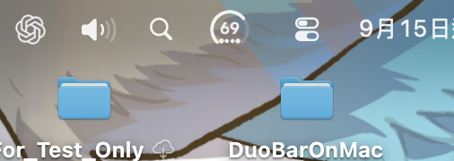

# DuoBarOnMac

一个原生 macOS 菜单栏状态工具，用一个简洁图标同时呈现 Mac 电池与 Wi‑Fi 状态，灵感来源于 iPhone Duo 的菜单栏图标。

A native macOS menu bar utility that combines Mac battery and Wi‑Fi status in one compact icon, inspired by the iPhone Duo menu bar icon.

最低支持 macOS 14，支持 Apple Silicon（arm64）。仓库包含 Swift 源码、自动化测试、构建脚本，以及可直接运行的预构建 `DuoBar.app`。

Requires macOS 14 or later and supports Apple Silicon (arm64). This repository includes the Swift source, automated tests, build scripts, and a ready-to-run `DuoBar.app`.

## 示例 · Screenshot



桌面环境示例截图。 · Example screenshot on the desktop.

## 功能 · Features

- 菜单栏图标实时显示 Mac 内置电池电量，并可在电池与 Wi‑Fi 状态之间切换中心显示内容。<br>
  Shows the built-in Mac battery level in the menu bar and lets you switch the center glyph between battery and Wi‑Fi.
- Wi‑Fi 状态包括连接状态、信号强度与网络名称（系统权限允许时）；信号显示可选三点或四点。<br>
  Shows Wi‑Fi connection status, signal strength, and network name (when permitted by macOS); choose a three-dot or four-dot signal display.
- 可分别开关充电、电池和 Wi‑Fi 配色；偏好会在重启后保留。<br>
  Independently enable or disable charging, battery, and Wi‑Fi colors; preferences persist across launches.
- 三点模式将最强的两个信号档位合并显示；颜色设置与点数设置彼此独立。<br>
  Three-dot mode combines the two strongest signal levels; color and dot-count preferences are independent.
- 电量圆环沿 270° 有效轨道线性显示电量，使用中性底轨与平端帽。<br>
  Displays battery level linearly along a 270° arc with a neutral track and flat ends.
- 显示充电、低电量、充电暂停、Wi‑Fi 断开等状态，以及已连接的蓝牙设备。<br>
  Indicates charging, low battery, paused charging, disconnected Wi‑Fi, and connected Bluetooth devices.
- 提供 SwiftUI 详情面板、登录时启动与退出操作；根据浅色或深色外观适配状态颜色。<br>
  Includes a SwiftUI details panel, launch-at-login and quit controls, and status colors adapted to light or dark appearance.
- macOS 26 及以上使用原生 Liquid Glass 详情面板；旧系统保留普通毛玻璃。<br>
  Uses native Liquid Glass for the details panel on macOS 26 and later, with a material fallback on older systems.
- 支持简体中文、繁体中文、日语、英语、法语、德语和西班牙语，并提供 VoiceOver 信号强度说明。<br>
  Localized in Simplified Chinese, Traditional Chinese, Japanese, English, French, German, and Spanish, with VoiceOver signal-strength descriptions.
- 不扫描附近 Wi‑Fi 网络。<br>
  Does not scan for nearby Wi‑Fi networks.

## 下载与运行 · Download and Run

从 [GitHub Releases](https://github.com/Longhorn5048/DuoBarOnMac/releases/latest) 下载最新版本，解压后打开 `DuoBar.app`。仓库根目录也包含 v0.1.3_1 Apple Silicon（arm64）预构建版本。

Download the latest version from [GitHub Releases](https://github.com/Longhorn5048/DuoBarOnMac/releases/latest), unzip it, and open `DuoBar.app`. The repository root also contains a prebuilt v0.1.3_1 app for Apple Silicon (arm64).

发布版本使用本地 ad-hoc 签名，未经 Apple Developer ID 公证。若 macOS 首次运行时弹出安全提示，请在“系统设置 → 隐私与安全性”中允许打开。

Release builds use a local ad-hoc signature and are not notarized with an Apple Developer ID. If macOS shows a security prompt on first launch, allow the app under **System Settings → Privacy & Security**.

## 从源码构建 · Build from Source

需要 Xcode 26 或更高版本（包含 macOS 26 SDK）；构建的应用最低支持 macOS 14。

Requires Xcode 26 or later with the macOS 26 SDK. The built app runs on macOS 14 or later.

```sh
swift build
swift test --scratch-path /tmp/DuoBarOnMac-build
./Scripts/build-app.sh
open DuoBar.app
```

`Scripts/build-app.sh` 会生成 release 构建、组装 app bundle，并验证本地 ad-hoc 签名。

`Scripts/build-app.sh` creates a release build, assembles the app bundle, and verifies its local ad-hoc signature.

## 隐私 · Privacy

DuoBarOnMac 只读取显示状态所需的本机电池、Wi‑Fi、蓝牙和网络路径信息；不会上传数据，也不会扫描附近 Wi‑Fi 网络。

DuoBarOnMac reads only local battery, Wi‑Fi, Bluetooth, and network-path information needed to display status. It does not upload data or scan for nearby Wi‑Fi networks.

显示 Wi‑Fi 名称需定位权限（macOS 的系统要求）。在详情面板点击“显示名称…”授权；如果已拒绝，点击“允许定位…”前往系统设置。DuoBar 不收集位置，也不启动定位更新。

macOS requires Location Services permission to read the Wi‑Fi name. Choose **Show Name…** in the details panel to grant access, or **Allow Location…** to open System Settings if access was denied. DuoBar does not collect your location or start location updates.

## 更新日志 · Changelog

### v0.1.3_1 — 2026-11-15

- 修复打开详情菜单后出现的直角矩形外框，统一玻璃层与窗口内容的圆角裁切。
- 保留原生 Liquid Glass 和窗口阴影；应用内部版本号为 0.1.3，构建号为 5。

### v0.1.3_1 — 2026-11-15

- Fixed the rectangular outline around the details menu by applying matching rounded clipping to the glass surface and its hosting view.
- Preserved native Liquid Glass and the window shadow. The app version remains 0.1.3 with build number 5.

### v0.1.3 — 2026-11-15

- 修复 Wi‑Fi 名称无法读取：补充定位授权入口，授权后自动刷新；已拒绝授权时可前往系统设置。
- 菜单栏图标统一缩至 18 点，调整线条、数字与信号点比例，并校正垂直重心。
- macOS 26 及以上使用原生 Liquid Glass 详情面板；旧系统保留普通毛玻璃。
- 补充授权状态和图标居中测试；40 项测试通过，包含离线预览导出。

### v0.1.3 — 2026-11-15

- Fixed missing Wi‑Fi names by adding a Location Services permission action, refreshing after authorization, and linking to System Settings when access is denied.
- Reduced the menu bar glyph to 18 pt, scaled its strokes, text, and signal dots, and corrected its vertical alignment.
- Added native Liquid Glass to the details panel on macOS 26 and later, with a material fallback on older systems.
- Added permission-state and glyph-alignment coverage; all 40 tests passed, including offline preview exports.

### v0.1.2 — 2026-09-17

- 新增 Wi‑Fi 三点／四点显示选择；三点模式合并最强的两个信号档位。
- 新增充电、电池与 Wi‑Fi 三个独立配色开关，并持久化保存偏好。
- 校准电池圆环为 270° 线性轨道，使用中性底轨和平端帽。
- 补充圆环几何与图标预览导出测试。

### v0.1.2 — 2026-09-17

- Added a choice of three- or four-dot Wi‑Fi signal display; three-dot mode combines the two strongest signal levels.
- Added independent charging, battery, and Wi‑Fi color toggles with persistent preferences.
- Calibrated the battery ring to a linear 270° track with a neutral track and flat ends.
- Added ring-geometry and glyph-preview export tests.

### v0.1.1 — 2026-09-16

- 新增随 Wi‑Fi 信号强度变化的图标配色，可在外观设置中关闭，并适配浅色与深色外观。
- 增强 VoiceOver 信号强度说明；加入应用图标与七种语言本地化。

### v0.1.1 — 2026-09-16

- Added Wi‑Fi signal-strength colors with a setting to disable them, adapted for light and dark appearance.
- Improved VoiceOver signal descriptions; added the app icon and localization in seven languages.

### v0.1.0 — 2026-09-15

- 首个版本：原生 macOS 菜单栏电池与 Wi‑Fi 状态工具，支持七种语言及 macOS 14+ Apple Silicon。

### v0.1.0 — 2026-09-15

- First release: a native macOS menu bar utility for battery and Wi‑Fi status, localized in seven languages and supporting macOS 14+ on Apple Silicon.

## 作者与许可证 · Author and License

Copyright © 2026 Skyler（GitHub: [Longhorn5048](https://github.com/Longhorn5048)）。本项目采用 [Apache License 2.0](LICENSE)。再发布时请保留版权与许可证声明，并遵守 [`NOTICE`](NOTICE) 中的署名要求。

Copyright © 2026 Skyler ([Longhorn5048 on GitHub](https://github.com/Longhorn5048)). Licensed under the [Apache License 2.0](LICENSE). Redistributions must retain the copyright and license notices and comply with the attribution requirements in [`NOTICE`](NOTICE).
